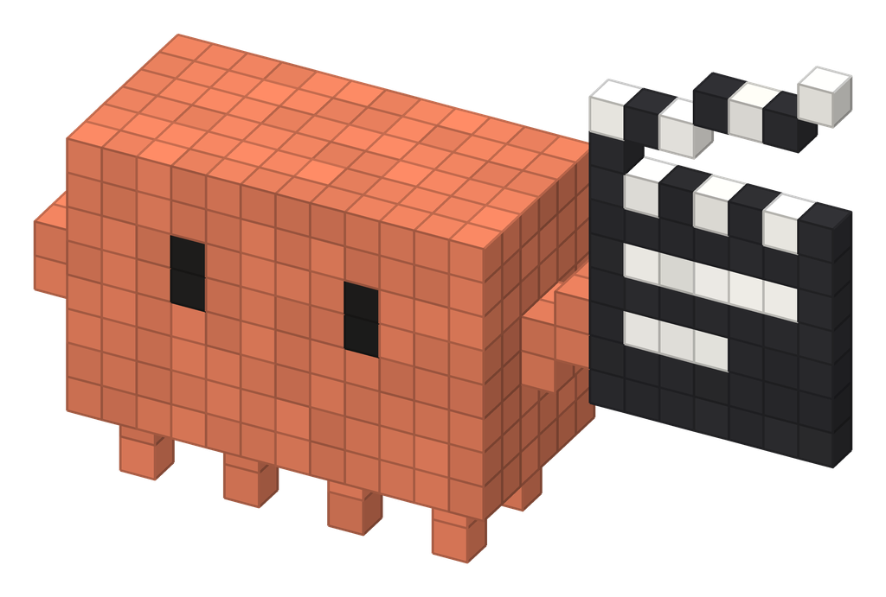

<p align="center">
  
</p>

# Explainer Video Maker

Turn docs, links, or text files into a narrated, animated explainer video (MP4).

## Features

- **Any material in**: a URL, uploaded files, a folder, pasted text, or just a topic to research. If a page can't be fetched, it reads it through Claude in Chrome before asking you.
- **Narrated or silent**: natural voiceover with a choice of US and British voices and adjustable speed, or a silent video timed to reading speed. Captions can be turned off.
- **Creative or faithful**: choose between original, minimal animations that explain the ideas (default), a balanced mix, or scenes that stick closely to the source and its screenshots.
- **Animated scenes**: diagrams, icon cards, typed terminal commands, flowcharts, and screenshots shown in browser mockups. Not just slides of text.
- **On-brand**: picks up the logo, colors, fonts, and screenshots from your site, so the video looks like yours.
- **Styles to fit the content**: suggests a look based on the material: Terminal dark, Clean corporate, Whiteboard, Paper cutout, Isometric, Blueprint, Flat vector story or Minimal monochrome, each optionally in your brand's logo, colors and fonts. See them side by side in the [style lookbook](references/style-lookbook.html).
- **Explainers or promos**: a full narrated explainer, or a 15–60 s promo cut to the beat of your music track, in Apple-style 3D or kinetic type.
- **Captions and chapters**: on-screen captions, a chapter header, and a progress bar.
- **Any size**: horizontal 16:9 (1920×1080), vertical 9:16 for Reels, TikTok and Shorts (1080×1920), square 1:1 (1080×1080), or a custom size such as 4:5 or 4K. Each size gets its own layout (not a crop), and you can ask for several sizes of the same video.
- **Free and offline**: no paid service or API key. The voice and the rendering run locally.
- **Guided setup**: asks a few short questions on one screen (length, voice, sound and captions, content approach). Change as many as you like, or keep the defaults. It asks where to save the video when there's no project to save into.
- **Works on desktop and web**: detects whether it's running in Claude Code on your machine or in the claude.ai cloud workspace, picks the right place for files, and checks that the local voice model can run (falling back to the system voice or a silent video if not).

## Install

**claude.ai**: zip the `explainer-video-maker` folder and upload it under **Settings → Capabilities → Skills**.

**Claude Code**: copy the folder into your skills directory:

```
# for all projects
cp -r skills/explainer-video-maker ~/.claude/skills/

# or for one project
cp -r skills/explainer-video-maker <your-project>/.claude/skills/
```

**Requirements** on the machine that builds the video: Python 3, Node.js, ffmpeg, and Chromium (for Playwright). The skill installs the Python and npm packages and downloads the voice model itself.

Then ask Claude something like *"make an explainer video from https://example.com"* or run `/explainer-video-maker`.

## How it works

The key idea: **the voiceover is the clock.**

1. **Read**: Claude fetches the links and files and, if allowed, collects brand assets (logo, colors, fonts, screenshots).
2. **Script**: it writes a short script, one chapter per section of the material, with spoken text and caption text for each line.
3. **Voice + timeline**: [Kokoro](https://github.com/thewh1teagle/kokoro-onnx), an offline text-to-speech model, speaks the script one sentence at a time. The exact start and end time of every sentence is saved to `timeline.json`.
4. **Scenes**: the animations are a single HTML page. Its whole state is a pure function of time, `renderAt(t)`, timed from the timeline, so each visual appears when its sentence is spoken. No CSS animations, timers, or randomness, so every frame can be reproduced.
5. **Review**: Claude renders still frames, checks them for layout problems, and fixes them before the full render.
6. **Render**: headless Chromium (Playwright) calls `renderAt(t)` for every frame at 30 fps and pipes screenshots to ffmpeg. Rendering is split into chunks that run in parallel.
7. **Mux + verify**: ffmpeg joins the chunks, adds the voice track with loudness normalization, and checks that audio and video durations match.

The result is an MP4 at the chosen size (1920×1080 by default) plus a timestamped narration script.

For a **promo**, the music is the clock instead: a small script finds the track's beats, each shot gets a whole number of beats, and cuts land on them. 3D promos use Three.js in the same headless browser, which renders more slowly.

## Folder layout

```
explainer-video-maker/
├── SKILL.md                      # the pipeline Claude follows
├── styles/                       # one file per style: tokens, fonts, layout, motion rules
├── formats/promo.md              # music-timed promo format (beats, shots, mux)
└── references/style-lookbook.html  # live previews and working code for every style
```
